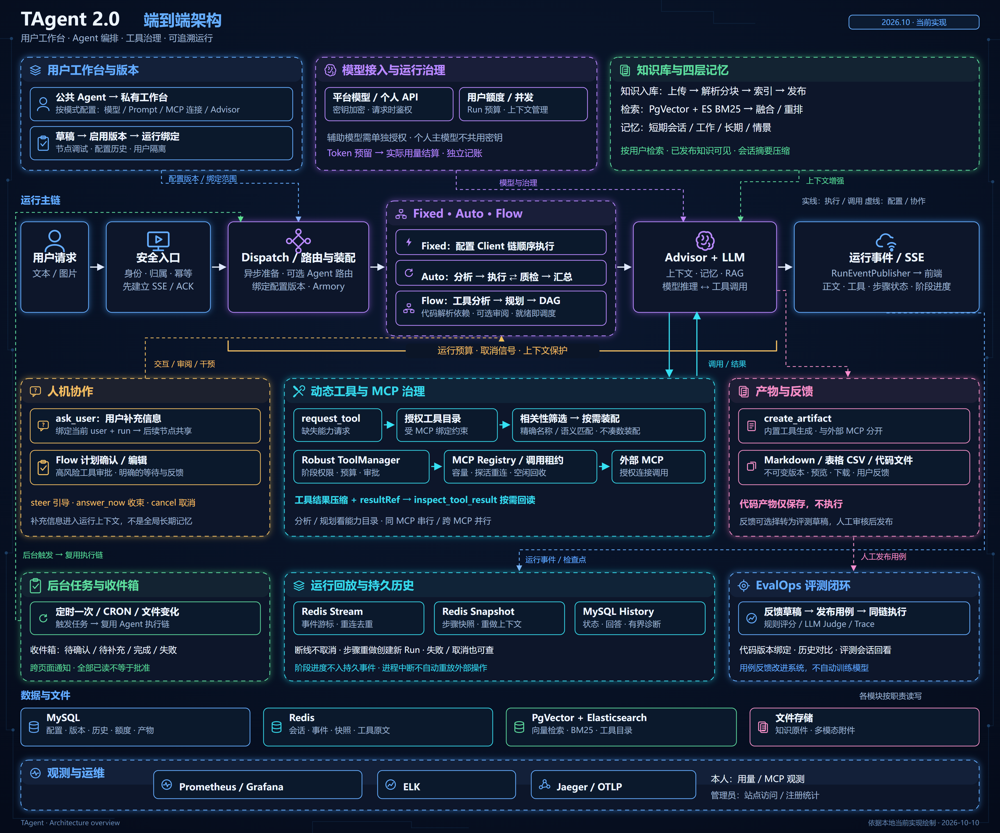

# TAgent

<div align="center">

🚀 **面向生产实践的 AI Agent 工程框架**

[](https://opensource.org/licenses/MIT)
[](https://www.oracle.com/java/)
[](https://spring.io/projects/spring-boot)
[](https://spring.io/projects/spring-ai)
[](https://github.com/pengmoubuaixuexi/TAgent/actions/workflows/ci.yml)
[](https://github.com/pengmoubuaixuexi/TAgent)

[英文版](./README_EN.md) | 中文版

> 不只是简单的模型封装，而是覆盖 Agent 请求的完整生命周期：接入、路由、运行时装配、规划执行、RAG、记忆、MCP 工具治理、人工审批、交互通知、执行中干预，到 SSE 流式输出和全链路观测。

</div>

---

## 📖 项目简介

TAgent 是一个基于 **Java 17**、**Spring Boot**、**Spring AI** 和 **DDD 分层架构** 构建的企业级 AI Agent 工程实践项目。

它覆盖了一次 Agent 请求从**接入、路由、运行时装配、规划执行、RAG、记忆、MCP 工具治理、人工审批、交互通知、执行中干预**，到 **SSE 流式输出和全链路观测**的完整过程。

*本仓库是脱敏后的公开版本，不包含真实密钥、运行日志、历史对话、临时报告、数据库备份和个人文件。*

> **🌐 在线体验：[https://tagentapp.cn](https://tagentapp.cn)**
>
> 注册后既可以体验预配置的各类 Agent，也可以进入“我的 Agent”自行搭建 Fixed、Auto、Flow 三种模式的 Agent，按节点配置 System Prompt、MCP 连接和 Advisor，并关联自己的 RAG 知识库。个人 Agent 配置、知识检索和使用观测按用户隔离。
>
> 目前处于试用阶段，平台提供的模型主要为 `mimo-v2.6-flash` 和 `deepseek-v4-flash`，受平台试用额度限制。**v2.0.0 已支持个人 OpenAI 兼容模型连接**：配置自己的接口、模型和 API Key，密钥加密保存。路由、记忆摘要、向量检索等平台辅助服务需要单独授权，不会借用个人主模型密钥。个人模型与 MCP 连接均受部署方允许域名限制。[Agent 工作区](docs/dev-ops/USER_AGENT_WORKSPACE.md) · [模型连接与加密配置](docs/dev-ops/MODEL_CONNECTIONS.md)，项目提供了图片理解能力，但是这与模型的能力有关，如果想要体验图片理解功能可以使用测试Agent运行，其搭配的是mimo-v2.6-flash具有图片理解能力。

## 🆕 v2.1.0：知识库入库更快，并有清晰的配额

- **入库提速**：每个父块只调用一次模型，同时生成小标题和全部子块的检索上下文，并发处理多个父块；同一篇约 170 个片段的论文从 30 分钟超时缩短到约 3 分钟。
- **失败可续做**：重试时跳过已完整写入的段落；增强模型不可用时文件仍会入库，并明确提示有多少段落未生成上下文。
- **按用户配额**：文件数、存储空间、每日入库次数（含重试）、排队数量和单文件规模均有上限，知识库页面显示用量；管理员不受限。升级需执行 [V070](docs/dev-ops/sql-migrations/V070__knowledge_ingestion_resume_and_quota.sql)，详见[升级指南](docs/dev-ops/V2_UPGRADE.md#v210-升级)。

## 🆕 v2.0.0：从配置到运行，再到可保存的结果

- **自己的 Agent 与模型**：从公共 Agent 开始，按模式配置节点；草稿、启用版本和运行绑定分开，支持版本比较、恢复到草稿及节点调试。个人模型密钥按用户隔离并加密保存。
- **可维护的知识库**：上传后可查看入库阶段、失败原因、片段预览，支持重试、取消、删除和检索测试；只有发布成功的知识才参与正常检索。
- **可追溯的执行**：运行历史持久保存问题、结果、配置版本、状态和有限诊断；刷新恢复步骤依赖与工具卡片，离开任务页面也能收到完成/失败通知，收件箱支持全部已读。
- **真正可下载的产物**：内置 `create_artifact` 生成 Markdown、表格 CSV 和单个代码文件，支持预览、下载、不可变修订及指定版本复用；代码仅保存，不执行。
- **反馈进入评测**：将本人反馈主动转为 EvalOps 草稿，审核启用后用规则评分、LLM Judge 和逐例对比验证改进；不会自动把模型原答案当成标准答案。
- **运行与用量治理**：运行预算、上下文压缩、工具结果按需回读、MCP 连接容量/空闲回收，以及按用户保存的平台额度与请求用量。金额未接入真实定价时显示未知，不作为实际账单。

工作台通过统一导航连接模型、Agent、知识库、历史、产物与反馈、用量和 MCP 观测。[查看 v2.0.0 升级与功能指南](docs/dev-ops/V2_UPGRADE.md)。

### 适合谁

- 想系统学习 **Java / Spring AI Agent 工程化落地**的开发者。
- 正在研究 **MCP 工具治理、动态工具补挂、Agentic RAG、多层记忆**的同学。
- 需要参考 **流式 SSE、人工审批、执行中干预、主动追问 ask_user、可观测性**完整链路的团队。

---

## 🎯 系统总览



[查看高清图](docs/images/tagent-end-to-end-architecture-v2.0-2026-10.png) · [可编辑 SVG](docs/images/tagent-end-to-end-architecture-v2.0-2026-10.svg)

## 🎬 功能演示

已有录屏覆盖三种策略、动态工具补充、主动追问、计划确认、人工审批、通知收件箱、运行编号重做、长期记忆管理、断线续作、图片理解、后台任务与观测页面。部分录屏来自早期版本，界面与阶段权限以 v2.0.0 当前实现为准：[查看功能演示录屏](docs/demo-videos/README.md)。

### 主链路

```text
用户请求
  -> 过滤器 / SSE 控制器
  -> 统一 Agent 路由
  -> Fixed / Auto / Flow 三种策略
  -> Advisor 顾问链 + LLM
  -> MCP 工具执行
  -> SSE 流式响应
```

### 主链之外的关键控制链

- **动态工具补充**：路由可预推断缺失能力，也可由执行期 `request_tool` 主动描述能力缺口 → PgVector 匹配真实 MCP 工具 → 与 Agent 常驻工具合并
- **Flow 计划确认**：仅 Flow 策略在生成并解析计划后可暂停，用户确认或编辑计划后再进入 DAG 执行
- **运行编号快照重做**：Fixed、Auto、Flow 每次运行都会生成运行编号；前端可通过 `/run` 查看近期快照，并用 `/runId-stepN` 从指定步骤修正重跑
- **断线续作与重连**：浏览器连接只是 run 的订阅者；刷新、网络抖动或切换会话不取消后端执行，重连后恢复完整 Timeline 并继续接收实时事件
- **后台任务中心**：独立命令路由识别定时、Cron 和文件变化稳定监视任务，确认后由调度器在目标会话触发普通 Agent run
- **执行中干预**：用户可发送 `steer` 重做当前步骤、`answer_now` 跳过剩余步骤、`cancel` 中止执行
- **主动追问**：模型缺少关键信息时可调用 `ask_user`，通过 SSE 向用户收集补充信息，再回填继续执行
- **交互通知收件箱**：统一保存主动追问、工具审批、计划确认和后台任务结果；当前会话内隐藏待交互铃铛提醒，切走后仍待处理时自动显示
- **按需证据地图**：用户可从最终回答主动生成 Evidence Map，把成块结论关联到本次 Run 的 RAG、工具、记忆与用户输入来源，并可查看全部运行来源

---

## ✨ 项目亮点

| 能力 | 实现 |
|---|---|
| **三种 Agent 模式** | Fixed 按配置的 Client 链顺序执行、Auto 分析执行闭环、Flow DAG 编排 |
| **个人 Agent 工作区** | 按模式配置节点、Prompt、模型、MCP 与 Advisor；草稿、启用版本、版本比较和节点调试 |
| **个人模型与额度** | 加密保存 OpenAI 兼容 API Key，单独授权平台辅助服务，持久记录本人额度及实际/未知用量 |
| **知识库管理** | 入库进度、失败续做、片段预览和检索测试，按用户配额与发布状态过滤 |
| **产物与反馈** | Markdown、CSV、代码文件与版本下载；反馈主动转为评测草稿 |
| **数据库驱动装配** | Agent、Client、Model、Prompt、Advisor、RAG、MCP 关系由数据库配置 |
| **统一 Agent 路由** | 一次模型调用选择 Agent，并输出可能缺失的工具能力；已选 Agent 也可按配置预推断 |
| **动态 MCP 工具** | 路由预推断与 `request_tool` 元工具并存，结合工具目录中文化、意图扩写、PgVector 语义匹配按请求临时补挂 |
| **MCP 自愈** | 懒探活、失败重试、超时重连、dead-client 重建、冷却与熔断 |
| **工具治理** | 按阶段区分目录读取、元工具与业务调用；相关性筛选、上下文与运行预算、按副作用决定重试 |
| **Flow 计划确认** | Flow 计划解析后暂停，支持用户查看、编辑、确认后继续 DAG 执行 |
| **运行编号步骤重做** | Redis TTL 快照保存运行步骤，支持 `/run` 查看、`/runId-stepN` 定点重做 |
| **断线续作与 Timeline 重连** | Snapshot 首屏恢复、Redis Stream 补增量、SSE 接实时流，完成态仍可恢复步骤与工具卡片 |
| **后台任务中心** | 一次性定时、Spring Cron、文件变化稳定监视，支持确认、编辑、暂停、恢复、立即执行与触发记录 |
| **多模态图片消息** | URL、文件选择和剪贴板图片统一转存 OSS，以 `text + image` 保存到 ChatMemory 并按模型能力发送 |
| **Agentic RAG** | SIMPLE、HyDE、FUSION、DECOMPOSE 四种查询策略 |
| **四层记忆** | 工作记忆、对话记忆、长期记忆、情景记忆 |
| **流式干预** | Auto、Flow、Fixed 均支持立即回答、引导与取消执行 |
| **主动追问** | `ask_user` 通过 SSE 向用户请求补充信息，默认关闭、按 session 限次和超时 |
| **人机协同** | 高风险工具调用通过 SSE 请求人工批准或拒绝 |
| **交互通知收件箱** | 保存追问、审批、计划与运行完成/失败通知，支持跳转、全部已读、归档；已读不代表批准 |
| **可解释输出** | 工具进度、RAG/记忆相关度、步骤状态，以及按需生成并缓存的 Evidence Map |
| **全链路观测** | Prometheus、ELK、Jaeger、event_log、本人模型用量与 MCP 健康页；网站统计限管理员 |

---

## 🔄 端到端请求流程

### 1. 接入与 SSE 建连

请求进入 `POST /api/v1/agent/auto_agent` 后依次经过：

1. `MdcTraceFilter`：写入 request、trace、user、tenant、session 等上下文
2. `RateLimitFilter`：按用户、会话或 IP 进行限流
3. `IdempotencyFilter`：同步请求支持幂等，SSE 长连接端点直接放行
4. `AiAgentController`：创建 `ResponseBodyEmitter`、注册审批通道并立即发送 `ack`
5. Controller 组装 `ExecuteCommandEntity`，交给 Dispatch 异步执行

`ack` 会携带干预能力是否开启，前端据此决定是否显示执行中的操作栏。

### 2. 统一路由与懒装配

`AgentDispatchService` 负责：

- 用户未指定 Agent 时，调用 `UnifiedAgentRouter` 选择最合适的 `agent_id`
- 用户已经指定 Agent 时，跳过 Agent 选择，直接使用该 Agent 的策略和装配配置；可按 `agent.dynamic-tools.infer-on-selected-agent` 决定是否继续推断缺失工具能力
- 路由结果可携带 `missing_tool_descs`，由 `agent.dynamic-tools` 配置决定是否在本次请求中预补工具
- 执行阶段如果模型发现当前工具不足，可在 `agent.request-tool.enabled=true` 时调用 `request_tool` 动态装载真实 MCP 工具
- 首次使用 Agent 时通过 Armory 懒加载 ChatClient、Model、Advisor 和 MCP callback
- 从数据库读取 Agent 的 `strategy`，分派到 Fixed、Auto 或 Flow

---

## 🏃 三种执行模式

### Fixed 模式

按配置的 Client 链顺序执行；单节点时适合直接问答或工具任务：

```text
准备上下文 -> 注入 Advisor -> 合并工具 -> LLM 流式生成 -> 保存记忆 -> 输出
```

也支持 MCP 工具调用、RAG、长期记忆、`steer` 重做、`answer_now` 提前结束。

### Auto 模式

适合目标明确但需要自主分析、执行和检查的任务：

| 步骤 | 职责 | 是否开放业务 MCP |
|---|---|---|
| Step1 | 分析任务、判断完成度 | ❌ |
| Step2 | 执行具体任务 | ✅ |
| Step3 | 质量检查与 Reflexion | ❌ |
| Step4 | 汇总最终结果 | ❌ |

Auto 会循环执行，直到任务完成或达到 `maxStep`。Step3 判断失败时，可携带结构化 critique 返回 Step2 修正。

### Flow 模式

适合可拆解、存在依赖关系的复杂任务：

| 步骤 | 职责 | 是否开放业务 MCP |
|---|---|---|
| Step1 | 阅读执行节点授权目录，分析工具能力 | ❌ |
| Step2 | 生成带 `DEPENDS_ON` 的步骤计划 | ❌ |
| Step3 | 将计划解析为 DAG | - |
| Step4 | 按依赖关系并行执行并最终整合 | ✅ |

分析/规划可读取执行节点所绑定 MCP 的工具名称和说明，无需先连接或装载全部工具；实际调用与 `request_tool` 留到执行阶段。`ask_user` 按阶段规则开放，Auto 最终总结与 Flow 最终合成可以使用内置 `create_artifact`，不因此开放业务 MCP。

DAG 中依赖已经满足的步骤可以并行，不同 MCP Server 的工具可以并行，同一个 MCP Server 复用同一连接时保持串行。

Flow 还可以开启计划确认：Step2 生成计划、Step3 解析为 DAG 后先暂停，把计划以工具卡片形式展示给用户；用户可以直接确认，也可以编辑步骤标题、内容和依赖关系后再继续执行。这个能力只属于 Flow 策略，不影响 Fixed 和 Auto 的默认直跑流程。

---

## 🔁 运行编号快照与步骤级重做

每次 Agent 运行都会生成一个运行编号，用来串联本次请求的 SSE、对话记忆、事件日志和 Redis 运行快照。

- **快照范围**：Fixed 记录单次回答快照；Auto 记录 Step1-Step4；Flow 记录计划阶段和 Step4 中的 DAG 执行步骤。
- **存储方式**：运行快照保存在 Redis，并设置 TTL；过期后需要重新发起任务，而不是沿用旧计划或旧工具结果。
- **前端入口**：输入 `/run` 展示当前会话近期运行，只展开运行摘要；选择某个运行编号后再展示可重做步骤。
- **定点重做**：输入 `/runId-stepN 修正要求` 后，系统继承源运行的 Agent 和前置步骤，并从目标步骤继续生成新回答。
- **持久历史**：MySQL `ai_run_history` 保存本人问题、回答、Agent 版本、状态和有上限的诊断，失败/取消的评测会话也能查看。历史查看不依赖 Redis TTL；真正能否步骤重做仍以有效快照为准。进程中断后不会自动重放外部操作。

---

## 🔌 断线续作与 Timeline 重连

Agent run 的生命周期归 session 管理，不再绑定某一个浏览器 SSE 连接。刷新、网络抖动或离开当前会话时，后端继续运行；只有显式取消才会按 `sessionId + runId` 终止目标 run。

重连按三段恢复：先加载已聚合的 Timeline Snapshot，再读取 Redis Stream 中快照游标之后的事件，最后订阅实时流。运行完成后仍可从最终快照恢复步骤文本、工具调用、记忆/RAG 依据、审批与主动追问卡片。

---

## ⏰ 后台任务与对象监视器

聊天入口会先由独立的 `BackgroundTaskCommandRouter` 判断是否属于后台任务命令，不改变 Fixed、Auto、Flow 的普通意图路由职责。当前支持：

- `SCHEDULE_ONCE`：指定时间触发一次。
- `CRON`：使用六段 Spring Cron 和时区周期触发。
- `FILE_CHANGE_STABLE`：文件内容变化后，持续指定时间未再修改时触发。

创建结果先保存为草稿，由用户确认后启用。任务中心支持编辑、暂停、恢复、立即执行、取消、查看触发记录和进入目标会话；触发时复用普通 Agent run，同一 session 同时只允许一个 run，繁忙时任务会等待会话空闲。

---

## 🛠️ 动态 MCP 工具补充

固定给每个 Agent 挂大量工具，会增加上下文、工具幻觉和选错工具的概率。TAgent 将工具拆成"常驻工具"和"按请求动态补充工具"。动态补充支持两条互补路径：路由阶段根据 `missing_tool_descs` 预推断，或模型在真实执行中通过 `request_tool` 主动描述能力缺口。

```text
UnifiedAgentRouter
  -> missing_tool_descs（路由预推断）
  或 Advisor / LLM
  -> request_tool(needs)（执行期补充）
  -> 优先匹配授权目录中的明确工具名
  -> 其余能力描述生成 embedding
  -> PgVector 查询 mcp_tool_vector
  -> 每类能力取 Top-K
  -> 相似度与名称/描述依据筛选，不强行补满
  -> 多类结果并集去重
  -> 懒创建或复用 MCP callback
  -> 常驻工具 + 动态工具
  -> 注入本次请求 / run
```

工具资产由两部分组成：
- MySQL `ai_mcp_tool_catalog`：真实工具名、MCP、原始描述、中文描述和中文意图
- PgVector `mcp_tool_vector`：用于语义检索的工具向量

用户在工作台绑定 **MCP 连接**，具体工具在执行时按需装载。Flow 分析/规划只阅读执行节点的授权能力目录，区分“已绑定”“已装载”和“已执行”，此时不开放 `request_tool`。

执行期 `request_tool` 优先匹配明确工具名，再结合向量相似度与名称/描述依据筛选；不会为了补满 Top-K 装配低相关工具。向量不可用时仅在授权目录内回退名称/描述匹配，找不到就明确返回无匹配。MCP 绑定和公共目录授权始终参与范围校验，工具目录可见不代表已经调用或验证连通性。

---

可选的免费联网搜索示例：[Parallel Search MCP 配置与 smoke test](docs/dev-ops/parallel-search/README.md)。

---

## 🔧 MCP 工具治理与自动重连

MCP 调用不是直接执行裸 callback，而是经过 `MeteredToolCallback`、`RobustToolCallingManager` 和 `McpClientRegistry` 三层治理。

### McpClientRegistry

Registry 维护 MCP Client、工具与 MCP 的映射、重建工厂、最近成功时间、连续失败次数和熔断状态。

自愈路径包括：

1. 工具调用前按需进行懒探活
2. 首次调用失败后执行有限重试
3. 超时后再次探活，判断连接仍存活还是已经死亡
4. dead-client 或发送失败时重建 MCP Client
5. 重建成功后刷新旧 `MeteredToolCallback` 内部 delegate
6. 同一 MCP 设置 10 秒重连冷却，避免连续抖动和重连风暴
7. 连续失败进入熔断状态时跳过无意义重连

重连后对模型暴露的 ToolDefinition 保持稳定，因此工具参数提示不会因 callback 切换而丢失。连接池同时管理全局/用户容量、活跃租约和空闲回收。重试按工具副作用与结果确定性处理；结果未知的写操作不会自动重放。

大体积工具结果先压缩后进入上下文，原结果通过受用户和运行归属约束的 `resultRef` 保存，模型可用 `inspect_tool_result` 按需回读。发送模型前继续检查输入预算，保留用户约束、来源引用及完整的工具调用/结果配对。

---

## 📚 Advisor 链

Advisor 由数据库配置，并按 order 参与请求：

| Advisor | 作用 |
|---|---|
| Semantic Cache | 相似问题命中后直接短路后续链路 |
| 长期记忆 | 注入长期画像和语义记忆，结束后异步抽取新记忆 |
| 情景记忆 | 注入当前会话或跨会话摘要 |
| Prompt Injection | 检测潜在提示词注入 |
| PII Mask | 对输入或输出中的敏感信息进行处理 |
| Agentic RAG | 判断是否检索以及选择查询策略 |
| Rag Answer | 执行混合检索、rerank、父子文档替换和引用组装 |
| 对话记忆 | 只读历史上下文，完整回答由应用层写入 |
| CoVe | 对回答声明进行检索核验与观测 |

---

## 🧠 Agentic RAG

RAG Router 会先判断是否需要检索，再从四种策略中选择：

| 策略 | 说明 |
|---|---|
| SIMPLE | 重写原始查询后直接检索 |
| HYDE | 先生成假想文档，再用其语义进行检索 |
| FUSION | 生成多个查询变体，并通过 RRF 融合结果 |
| DECOMPOSE | 将多跳问题拆成多个子查询并行检索 |

检索链路：

```text
Query Planning
  -> PgVector 语义召回
  -> Elasticsearch BM25
  -> RRF 融合
  -> Cross Encoder / LLM Rerank
  -> Child 命中替换为 Parent Document
  -> 注入编号引用
  -> rag_evidence SSE
```

---

## 💾 四层记忆

| 记忆层 | 存储 | 用途 |
|---|---|---|
| 工作记忆 | Redis | 保存 Auto/Flow 步骤中间产物，支持步骤间读取和断线后的完成态回放 |
| 对话记忆 | MySQL + Redis 缓存 | 保存多轮聊天历史和滚动摘要 |
| 长期记忆 | MySQL 元数据 + PgVector | 保存用户画像、技能、偏好、计划和情况，支持语义召回 |
| 情景记忆 | MySQL | 保存会话阶段性摘要和近期经历 |

长期记忆包含：
- 固定画像槽位
- 情景记忆语义召回
- exact match 与语义去重
- 单值覆盖、累加记忆合并
- 冲突判断
- 访问热度继承与冷记忆归档
- 同一轮多步骤共享召回快照

---

## 🎮 执行中干预

Auto、Flow、Fixed 三种模式均支持 `steer`、`answer_now` 和 `cancel`。

### 引导 steer

```http
POST /api/v1/agent/steer
Content-Type: application/json

{
  "sessionId": "session_demo_001",
  "idea": "请重点从工程落地和风险控制角度分析"
}
```

行为：
- 中断当前正在生成的流，而不是等待步骤自然结束
- 保留当前 reasoning、半截输出和已有步骤结果
- 将新想法合并到有效用户问题
- 重做当前步骤，并将引导继续传递到后续步骤

---

## 🤔 主动追问 ask_user

当模型缺少完成任务所必需的信息，或用户意图存在多种合理理解需要拍板时，可以调用 `ask_user` 主动向用户追问。

流程：

```text
Advisor + LLM
  -> ask_user tool_call
  -> user_input_required SSE
  -> 用户补充回填
  -> ask_user tool result + 当前用户/运行的共享上下文
  -> 继续下一轮推理
```

设计边界：
- `agent.user-input.enabled=false` 时完全不广播 `ask_user`，默认不影响原链路
- `UserInputGate` 按 `sessionId` 限制追问次数，并支持超时自动放行
- `ask_user` 与人工审批互不复用 ID：审批管工具授权，`ask_user` 管需求澄清
- 回答写入当前用户与 run 的共享上下文，后续节点继续读取；不自动变成其他运行或其他用户的长期记忆

---

## 👨‍💼 人工审批

高风险工具可配置为执行前审批：

1. 后端发送 `human_approval_required` SSE 事件
2. 前端显示工具名、参数和审批原因
3. 用户调用审批接口
4. 批准后执行，拒绝或超时则向模型返回结构化错误

```http
POST /api/v1/agent/approval
Content-Type: application/json

{
  "approvalId": "approval-id-from-sse",
  "approved": true
}
```

---

## 📡 SSE 事件

| 事件 | 用途 |
|---|---|
| `ack` | 确认连接建立并返回干预开关 |
| `step_start` / `step_end` | 展示 Agent 当前步骤 |
| `token` | 逐 token 渲染回答 |
| `tool_call_start` / `tool_call_end` / `tool_call_error` | 展示工具进度 |
| `human_approval_required` | 请求人工审批 |
| `user_input_required` | 模型通过 `ask_user` 请求用户补充信息 |
| `rag_evidence` | 展示知识库引用依据 |
| `memory_evidence` | 展示记忆召回依据 |
| `data` | 返回步骤结果或最终结果 |

---

## 📦 生成文件与反馈

用户可以直接要求：“把本次行程保存为可下载的 Markdown，再生成 CSV 预算表；没有查到的信息明确标注。”内置 `create_artifact` 接收完整文档、结构化表格或单个源码文件，不依赖文件读写 MCP。数据库保存成功后，对话卡片提供预览/下载，产物页可查看修订和选择版本继续使用。

目前支持 `.md`、`.csv` 和按文件名下载的单个代码文件；代码只作纯文本预览与保存，不执行，也不代表已编译验证。暂不生成 Word、PDF、Excel 工作簿或多文件 ZIP。格式校验失败时允许一次修复，仍失败则明确说明文件未保存并回退正文，不把普通回答冒充下载文件。

用户反馈与具体 run / Agent 版本关联，可主动转为禁用状态的 EvalOps 草稿，人工审核启用后再评测。LLM Judge 可选本人有权使用的其他模型；评测调用同样受提供商授权、平台辅助服务同意及预算约束。

---

## 📊 可观测性

TAgent 同时记录模型、工具和 Agent 步骤：

- `LlmObservationRecorder`：模型、耗时、Token、缓存 Token、billing scope
- `ai_event_log`：步骤输入输出、路由、工具、干预和最终结果
- Prometheus：LLM 与 MCP 指标
- ELK：结构化日志与 MDC 上下文
- Jaeger：跨 Controller、Step、LLM 和工具调用 Trace
- `WireTraceRecorder`：在不消费下游响应体的前提下记录流式 wire 信息

页面：
- LLM 观测：`http://localhost:8099/observe.html`
- 我的用量与额度：`http://localhost:8099/usage.html`
- 模型连接：`http://localhost:8099/models.html`
- 我的知识库：`http://localhost:8099/knowledge.html`
- 运行历史：`http://localhost:8099/history.html`
- 产物与反馈：`http://localhost:8099/outcomes.html`
- MCP 观测：`http://localhost:8099/observe-mcp.html`
- 我的 Agent：`http://localhost:8099/user-agents.html`
- 网站访问与注册统计（管理员）：`http://localhost:8099/admin-stats.html`

---

## 📋 技术栈

- **Java 17**
- **Spring Boot 3.4.3**
- **Spring AI 1.1.7**
- **MCP SDK 0.18.2**
- **MyBatis、MySQL**
- **PostgreSQL + pgvector**
- **Redis**
- **Elasticsearch**
- **Resilience4j**
- **Reactor、SSE**
- **Micrometer、Prometheus、Grafana、Jaeger、ELK**

---

## 🏗️ 项目模块

| 模块 | 说明 |
|---|---|
| `ai-agent-station-study-api` | 接口、DTO 和统一响应 |
| `ai-agent-station-study-app` | Spring Boot 启动、配置、静态页面和 Mapper XML |
| `ai-agent-station-study-domain` | Agent 路由、执行策略、RAG、记忆、MCP 与安全治理 |
| `ai-agent-station-study-infrastructure` | DAO、Repository、缓存和外部存储适配 |
| `ai-agent-station-study-trigger` | HTTP Controller、管理接口和任务触发 |
| `ai-agent-station-study-types` | 通用类型、异常和任务调度组件 |
| `docs/dev-ops` | Docker、SQL 迁移、Grafana、Prometheus 和 MCP 配置 |
| `mcp-server-hmdp` / `mcp-servers` | MCP Server 示例 |

---

## 🚀 本地运行

单机部署与数据迁移请参考 [服务器部署指南](docs/dev-ops/server/README.md)和 [v2.0.0 升级指南](docs/dev-ops/V2_UPGRADE.md)。**从已完成 V063 的版本升级到 v2.0.0，需要按顺序应用 V064–V069**：个人模型连接、Agent 版本、知识库入库任务、持久运行历史、用量账本、产物与反馈。更早版本先核对 V061–V063 与管理员归属/共享范围；已应用的迁移不要重复执行。

升级前备份旧 JAR/镜像、配置、MySQL，以及已有的向量/关键词数据和应用文件卷，按部署指南进入维护窗口再迁移、启动新版本。保留固定的 `MODEL_SECRET_MASTER_KEY`：它是随机 32 字节的 Base64 编码，用于个人 API Key 加密，必须与数据库分别备份，重启或升级时不得重新生成。未配置时平台模型仍可用，个人密钥功能不可用。详情见[模型连接](docs/dev-ops/MODEL_CONNECTIONS.md)、[用量规则](docs/dev-ops/MODEL_USAGE.md)、[知识库入库](docs/dev-ops/KNOWLEDGE_INGESTION.md)和[运行历史](docs/dev-ops/RUN_HISTORY.md)。

### 外部依赖

默认地址：

| 服务 | 地址 |
|---|---|
| MySQL | `127.0.0.1:13306` |
| PostgreSQL + pgvector | `127.0.0.1:15432` |
| Redis | `127.0.0.1:16379` |
| Elasticsearch | `127.0.0.1:9200` |
| Logstash | `127.0.0.1:4560` |
| Jaeger OTLP | `127.0.0.1:4318` |

### 环境变量

```bash
# LLM 配置
LLM_BASE_URL=https://your-openai-compatible-endpoint
LLM_API_KEY=your-llm-key
LLM_MODEL=your-model

# 向量模型配置
EMBEDDING_BASE_URL=https://your-embedding-endpoint
EMBEDDING_API_KEY=your-embedding-key
EMBEDDING_MODEL=BAAI/bge-m3

# 可选：远程图片下载代理
TAGENT_IMAGE_PROXY_URL=http://127.0.0.1:7897

# 可选：私有 OSS 图片存储
TAGENT_OSS_ENABLED=false
TAGENT_OSS_BUCKET=your-private-bucket

# 数据库凭据
MYSQL_USERNAME=root
MYSQL_PASSWORD=your-mysql-password
PGVECTOR_USERNAME=postgres
PGVECTOR_PASSWORD=your-postgres-password
```

按需设置 MCP 和观测凭据：

```bash
GITHUB_PERSONAL_ACCESS_TOKEN=your-github-token
GRAFANA_API_KEY=your-grafana-key
CSDN_API_COOKIE=your-csdn-cookie
WEIXIN_API_APP_SECRET=your-weixin-secret
```

### 数据库迁移

增量脚本位于：

```text
docs/dev-ops/sql-migrations
```

新环境按照部署指南初始化基线库，再核对并执行尚未应用的增量迁移，v2.0.0 需要完成至 `V069`。不要在已有结构上盲目重跑全部脚本；MySQL DDL 不支持整份迁移的事务回滚。

### 构建

```bash
mvn "-Dmaven.test.skip=true" package
```

项目包含依赖外部服务和账号环境的集成测试。普通本地构建可跳过测试，验收时再运行指定测试类。

### 启动

```bash
java -jar ai-agent-station-study-app/target/ai-agent-station-study-app.jar
```

默认端口：`8099`

- 对话页：`http://localhost:8099/index.html`
- Agent 配置：`http://localhost:8099/agent-config.html`
- 健康检查：`http://localhost:8099/actuator/health`

---

## 📤 流式请求示例

v1.27.0 起，请先登录并携带会话 Cookie；POST 请求还需携带 `/api/v1/auth/csrf` 返回的 CSRF token（按返回的 `headerName` 设置请求头）。用户身份取自登录会话，示例中的 `userId` 不用于证明身份。浏览器页面的 `auth.js` 会自动处理。

```http
POST /api/v1/agent/auto_agent
Content-Type: application/json
Accept: text/event-stream
```

```json
{
  "aiAgentId": "3",
  "message": "总结当前系统的 Agent、RAG、记忆和 MCP 能力",
  "sessionId": "session_demo_001",
  "userId": "user_demo",
  "maxStep": 5
}
```

---

## ⚙️ 关键配置

```yaml
agent:
  intervention:
    enabled: true
  steer:
    enabled: true
    max-rounds: 3
  answer-now:
    finalize-tools: true
  user-input:
    enabled: false
    max-asks: 2
    timeout-seconds: 120
  request-tool:
    enabled: false
    max-calls: 3

  mcp:
    disable-tools-on-nonexec-steps: true
    tool-call:
      max-attempts: 2
      retry-delay-ms: 1000
      parallel-enabled: true
      max-serial-rounds-per-client: 3

  dynamic-tools:
    # 路由阶段缺失能力预推断；与执行期 request_tool 可并存
    infer-on-selected-agent: true
    per-need-top-k: 2
    max-extra-tools-per-request: 6
    match-cache-ttl-ms: 600000
  flow:
    plan-review:
      enabled: false
      store-enabled: true
      ttl-seconds: 7200
  run-snapshot:
    enabled: true
    ttl-seconds: 21600
    session-index-size: 30
  run-events:
    enabled: true
    ttl-seconds: 21600
  evidence-map:
    ttl-seconds: 604800
```

---

## 🔒 安全说明

公开仓库中不应提交：

- API Key、Access Token、Cookie、私钥
- `.local-config`、浏览器状态和本地凭据
- 运行日志、压测报告和临时调试文件
- 个人对话、简历和面试资料
- 数据库备份和生产数据

---

## 📝 更新记录

详见 [CHANGELOG.md](CHANGELOG.md)。

---

## 📄 许可证

本项目采用 [MIT License](LICENSE) 许可证。

---

## 🤝 贡献指南

欢迎 Issue、Pull Request 和讨论！我们非常期待你的建议和贡献。

**问题或建议？** [创建 Issue](https://github.com/pengmoubuaixuexi/TAgent/issues) 或 [发起讨论](https://github.com/pengmoubuaixuexi/TAgent/discussions) 🙌

---

<div align="center">

Made with ❤️ by pengmoubuaixuexi

</div>
